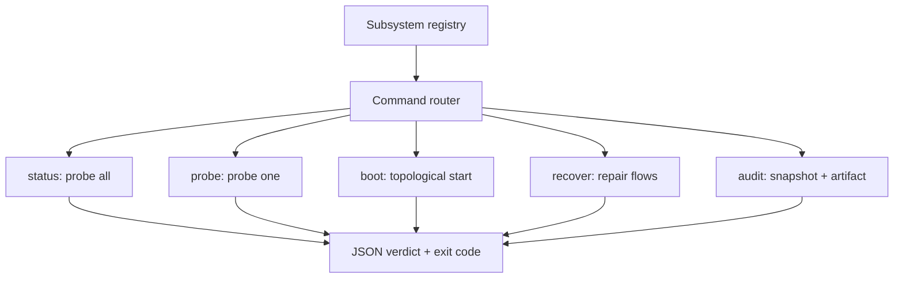

# mesh-studio

A command-line tool that checks, starts, and repairs a group of AI model
services. One command (`rig-mesh`) probes every service in your stack, boots
them in dependency order, and runs recovery flows when something is stuck.

[](https://github.com/mrodgersjs-web/mesh-studio/actions/workflows/ci.yml)
[](LICENSE)
[](https://www.python.org/)

## Why this exists

If you run AI workloads locally, you end up with model routers, queue runners,
dashboards, and healer daemons on a dozen ports, and no single answer to "is
everything up?". mesh-studio declares each piece as a Subsystem and gives you
one uniform way to see, start, recover, and prove their state. The core is
stdlib only, so it installs anywhere Python runs.

## Quickstart

```bash
pip install git+https://github.com/mrodgersjs-web/mesh-studio.git
rig-mesh smoke
rig-mesh status
rig-mesh probe --name litellm-mesh-router
rig-mesh audit
```

All output is JSON. Exit code 0 means healthy, 1 means warn or fail.

## Usage

`rig-mesh smoke` is the deterministic local check: it verifies the install and
the subsystem registry without touching the network.

```
$ rig-mesh smoke
{
  "checks": {
    "registry_populated": true,
    "subsystem_count": 17,
    "version_ok": true
  },
  "ok": true,
  "result": "PASS",
  "rig_master": "1.1.0",
  "verb": "smoke"
}
```

`rig-mesh status` probes every registered subsystem and returns one aggregate
verdict. Each subsystem picks the most authoritative probe it declares: HTTP
health endpoint, heartbeat file freshness, or launchd state.

## How it works



## What it proves

Run these yourself after install:

```bash
pytest -q            # 112 passed, 2 skipped on a plain machine
ruff check .         # All checks passed
rig-mesh smoke       # ok: true, exit 0
```

The two skips are dashboard tests that need the optional FastAPI extra; they
run in CI where the extra is installed. Test coverage on the package is 83%
(`pytest --cov=rig_mesh`).

## Project layout

```
src/rig_mesh/        the package: subsystems, probes, boot, recovery, CLI
tests/               pytest suite, run in CI on Python 3.10 to 3.13
docs/                architecture, CLI reference, MCP server, public boundary
examples/            runnable example, exercised by the test suite
scripts/smoke.sh     one-line install-and-smoke check
```

## Development

```bash
python3 -m venv .venv && . .venv/bin/activate
pip install -e '.[dev]'
pytest -q --cov
ruff check .
```

## Documentation

- [Architecture](docs/architecture.md): how the registry, probes, and flows fit together
- [CLI reference](docs/cli.md): every verb, config, and extension point
- [MCP server](docs/mcp.md): tools, resources, and prompts for agent clients
- [Public boundary](docs/public-boundary.md): what this repo does and does not publish

## Contributing

See [CONTRIBUTING.md](CONTRIBUTING.md). Short version: small diffs, tests
included, `ruff check .` and `pytest -q` green before you open a PR.

## Security

Report vulnerabilities to security@rodgersintelligence.com. See
[SECURITY.md](SECURITY.md) for supported versions.

## License

MIT. See [LICENSE](LICENSE).

---

Built by Mike Rodgers · rodgersintelligence.com
